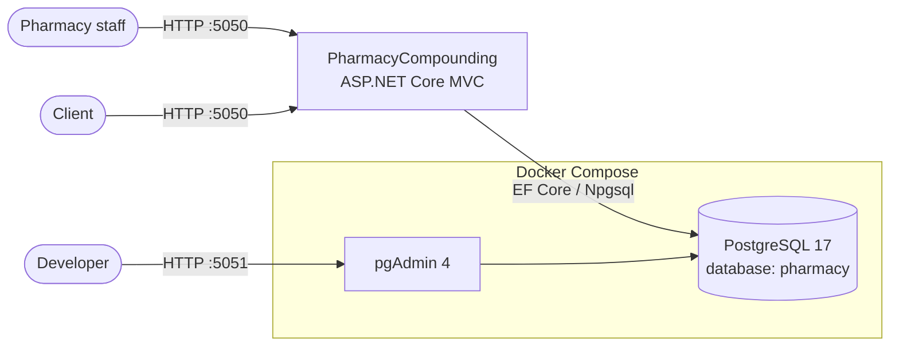
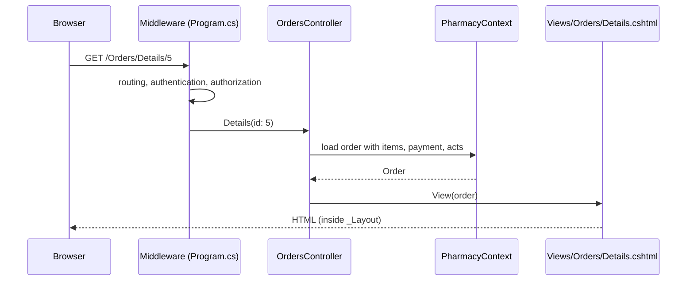
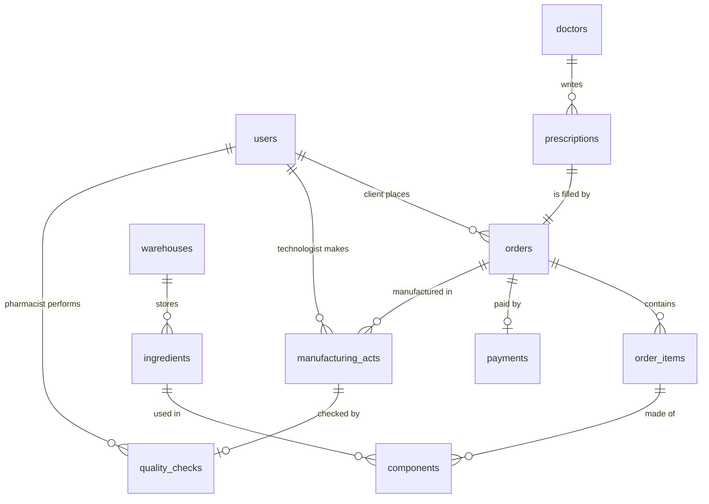
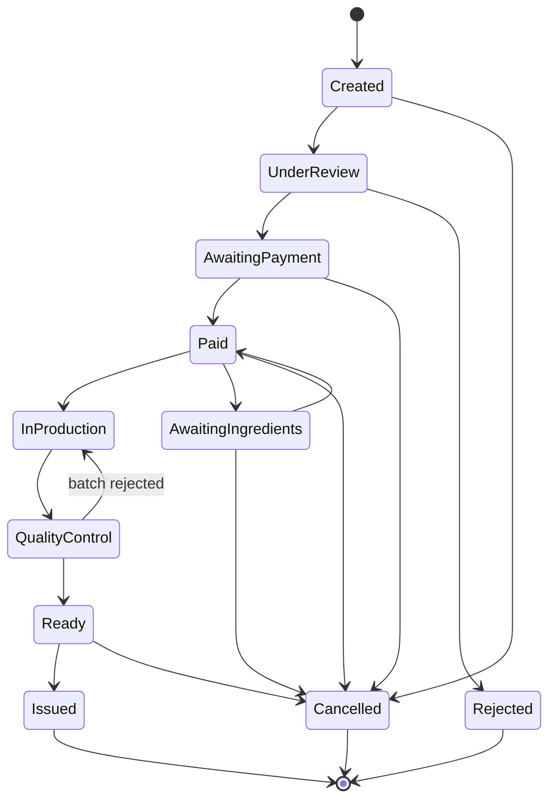

# Architecture

Pharmacy Compounding is a server-rendered ASP.NET Core MVC application (.NET 8) for a pharmacy that makes medicines to
prescription. It tracks an order from the prescription check through manufacturing and quality control to payment and
pickup. Data is stored in PostgreSQL and accessed through Entity Framework Core (Code First).

## System context

- The app runs on the host with `dotnet run`; PostgreSQL and pgAdmin run in Docker Compose.
- The UI is in Ukrainian and uses the `uk-UA` culture (with `.` as the decimal separator to match `<input type="number">`).

## Tech stack

| Concern         | Choice                                                                  |
|-----------------|-------------------------------------------------------------------------|
| Web framework   | ASP.NET Core MVC, Razor views, .NET 8                                   |
| Data access     | EF Core 8, Npgsql provider, `EFCore.NamingConventions` (snake_case)     |
| Database        | PostgreSQL 17 (`postgres:17-alpine`), pgAdmin 4 for inspection          |
| Auth            | Cookie authentication, role-based authorization, PBKDF2 password hashes |
| UI              | Bootstrap 5.1, Bootstrap Icons, jQuery unobtrusive validation           |
| Configuration   | `appsettings.json` + `.env` (loaded with `DotNetEnv`)                   |

There is no frontend build step: static assets are served from `wwwroot/` as is.

## Application structure

The project follows the standard MVC layout. Controllers use `PharmacyContext` directly; there is no separate service or
repository layer, because the domain logic is small and lives in the model classes themselves.

| Folder         | Responsibility                                                                               |
|----------------|----------------------------------------------------------------------------------------------|
| `Models/`      | Domain classes from the class diagram, including behavior such as order status transitions  |
| `Data/`        | `PharmacyContext` (mapping and relationships), `DbInitializer` (seed data), SQL interceptor |
| `Migrations/`  | Generated EF Core migrations                                                                 |
| `Controllers/` | One controller per area: orders, prescriptions, ingredients, warehouses, clients, doctors, employees, reports, account, client cabinet |
| `ViewModels/`  | Form and page models that don't map one-to-one to entities                                   |
| `Views/`       | Razor views; `Shared/_Layout.cshtml` holds the sidebar layout                                |

### Request flow

State-changing actions (verify, pay, manufacture, quality control, issue, cancel) are separate `POST` endpoints protected
with anti-forgery tokens. Each one loads the order, calls a domain method, saves and redirects back to the details page
(Post/Redirect/Get), with the outcome shown through `TempData`.

## Domain model

- **Users** use Table-Per-Hierarchy: `Client`, `Pharmacist`, `PharmTechnologist` and `PharmacyManager` share the `users`
  table, and the `user_type` discriminator also serves as the authorization role.
- **Composition** (order → items → components) uses `ON DELETE CASCADE`. Payments and manufacturing acts are deleted with
  their order, and quality checks with their act.
- **References** to independent entities (client, doctor, prescription, ingredient, warehouse, technologist, pharmacist)
  use `ON DELETE RESTRICT`, so history can't lose its references.
- Unique indexes: `users.email`, `orders.number`, `ingredients.code`.
- `orders.status` is stored as a string, so the data stays readable in SQL.

### Order lifecycle

Allowed transitions are defined in `Order.Transitions` and enforced by `Order.ChangeStatus`, which throws on an invalid
transition. Controllers never set `Status` directly.

An order and its prescription can be edited only while the prescription is not yet verified (`Order.IsEditable`:
`Created`, `UnderReview`). An order can be deleted, together with its prescription, only if it was never manufactured and
holds no successful payment (`Order.CanBeDeleted`); otherwise it can only be cancelled. The new order and edit order pages
share the `_OrderForm` partial, and `OrderEditViewModel` extends `OrderCreateViewModel`.

Starting manufacturing checks stock, writes off the ingredients and creates a manufacturing act. If an ingredient is
short, the order moves to `AwaitingIngredients` instead.

## Security

- **Authentication:** cookie-based, 7-day sliding expiration. Passwords are stored as PBKDF2 hashes.
- **Authorization:** a fallback policy requires a staff role (Pharmacist, Technologist or Manager) on every endpoint.
  Exceptions are explicit: `[AllowAnonymous]` for sign-in and sign-up, `[Authorize(Roles = Roles.Client)]` for the
  client cabinet, `[Authorize(Roles = Roles.Manager)]` for staff management.
- **Roles inside the staff** (`Roles.Pharmacy`, `Roles.Production` for attributes; `User.CanEdit()`,
  `CanManufacture()`, `CanDelete()` in views):

  | Action | Pharmacist | Technologist | Manager |
  |---|---|---|---|
  | View orders, prescriptions, stock, reports, directories | ✓ | ✓ | ✓ |
  | Create/edit orders, verify, take payment, quality control, issue, cancel | ✓ | | ✓ |
  | Manufacture | | ✓ | ✓ |
  | Create/edit clients, doctors, ingredients; replenish stock | ✓ | replenish only | ✓ |
  | Delete records, warehouses, staff, bulk maintenance reports | | | ✓ |

  Buttons a role can't use are hidden, and the controller actions check the same roles.
- **Clients** see their own orders, edit their profile (`/Cabinet/Profile`, the password changes only with the current
  one) and the contacts page.
- **Sign-up:** only clients can register themselves; employees are created by the manager.
- **Secrets:** database credentials live in `.env`, which is git-ignored. `appsettings.json` only has the host and port.

## Configuration and startup

1. `DotNetEnv` loads `.env` from the nearest parent directory without overriding variables that are already set.
2. The connection string is built from `ConnectionStrings:PharmacyDb` (host and port) plus `POSTGRES_DB`,
   `POSTGRES_USER` and `POSTGRES_PASSWORD`. A missing variable stops startup with a clear error.
3. On startup the app runs `Database.Migrate()` and `DbInitializer.Seed()`, so an empty database is created and seeded
   automatically. Seeding is skipped if data already exists, and a default manager account is always ensured.

Docker Compose reads the same `.env` file to initialize PostgreSQL and to generate the pgAdmin server definition and
password file (`configs` in `docker-compose.yml`), so the credentials are defined in one place.

## Data integrity (ACID)

- **Atomicity:** each user action ends with one `SaveChanges`, which EF Core runs in a single transaction (status,
  payment, manufacturing act and stock write-off together). Bulk `ExecuteDelete`/`ExecuteUpdate` statements bypass
  `SaveChanges`, so the cleanup report wraps them in an explicit transaction.
- **Consistency:** besides foreign keys, the database has check constraints (non-negative stock, prices, totals and
  amounts; validity of 1–365 days) and unique indexes on `prescriptions.number`, `doctors.license_number` and
  `warehouses.name`. The app validates the same rules first to show a friendly message.
- **Isolation:** `orders` and `ingredients` use optimistic concurrency on PostgreSQL's `xmin` system column
  (`Version` properties). A conflicting save throws `DbUpdateConcurrencyException`, and the user gets a message instead
  of silently overwriting someone else's change. Order numbers come from the `order_numbers` sequence instead of
  `MAX + 1`.
- **Durability:** PostgreSQL commits to its write-ahead log; data lives in the `pgdata` Docker volume.

`TransactionCaptureInterceptor` adds `BEGIN` / `COMMIT` / `ROLLBACK` to the SQL panel of the report pages.

## Reports

`/Reports` (`ReportsController`) runs LINQ queries against the database, grouped as filtered lists, totals (aggregation
over a user-selected period, grouping, joins, PLINQ) and maintenance tools (insert, and bulk update/delete with
`ExecuteUpdate` / `ExecuteDelete`).

To show the SQL that each LINQ query produced, `SqlCaptureInterceptor` (a singleton `DbCommandInterceptor`) appends every
command and its parameter values to `HttpContext.Items` for the current request. The view renders them in a collapsed
panel under the result. `ReportViewModel` describes the form parameters, result table and totals, so all reports share a
single view.

## Key decisions

| Decision | Reason |
|---|---|
| PostgreSQL in Docker instead of SQL Server LocalDB | LocalDB is Windows-only; Docker gives the same setup on any OS with one command |
| Code First with migrations | The schema follows the class diagram and is versioned with the code |
| Table-Per-Hierarchy for users | One login table, simple role lookup, and polymorphic queries over employees |
| snake_case naming | PostgreSQL folds unquoted identifiers to lower case, so hand-written SQL works without quotes |
| Domain logic in models, no service layer | The app is small; status rules stay next to the data they protect |
| `Npgsql.EnableLegacyTimestampBehavior` | Dates in the domain have no time zone, so they are stored as `timestamp without time zone` |
| Credentials in `.env` | Keeps secrets out of git and shares one source of truth between the app and Docker Compose |
